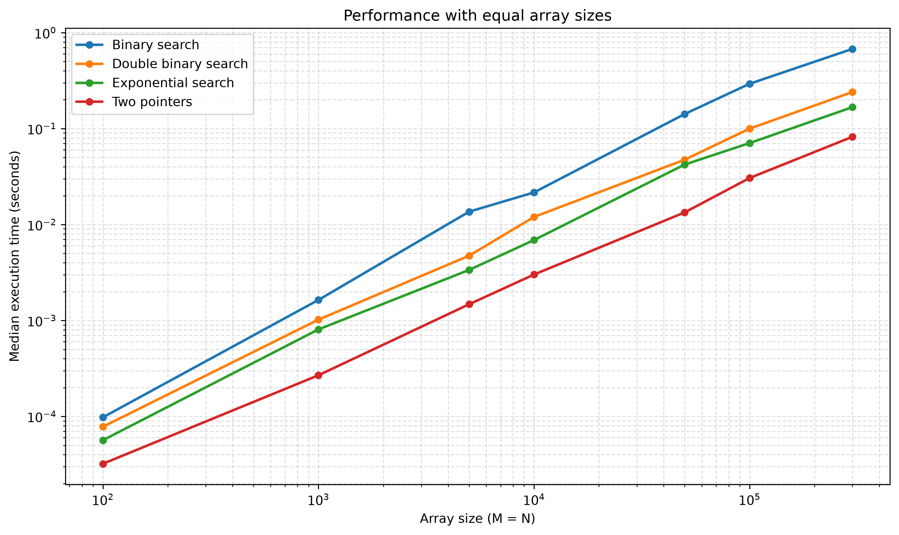
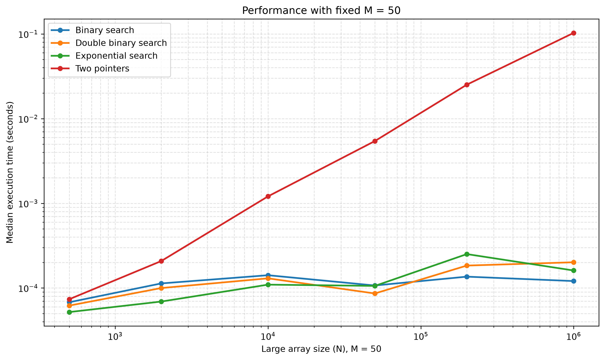
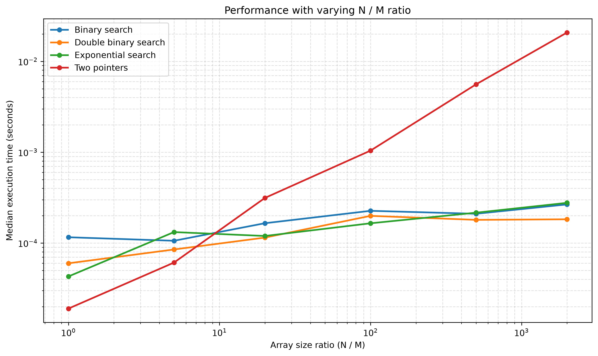

# Описание лабораторной работы

## Задача

Проверить, есть ли хотя бы один общий элемент у двух отсортированных по неубыванию массивов `A` (размер `M`) и `B` (размер `N`).

Реализованы 4 алгоритма. Цель — сравнить их на худшем случае (пересечения нет) и понять, при каких соотношениях размеров какой алгоритм быстрее.

| Алгоритм | Файл | Идея | Время (худший случай) | Доп. память |
|---|---|---|---|---|
| Два указателя | `algorithms/two_pointers.py` | Один проход по обоим массивам | `O(M + N)` | `O(1)` |
| Бинарный поиск | `algorithms/binary_search.py` | Для каждого элемента короткого массива ищем его в длинном | `O(M log N)` при `M ≤ N` | `O(1)` |
| Экспоненциальный поиск | `algorithms/exponential_search.py` | От текущего индекса в `B` прыжки `1, 2, 4, …`, затем локальный бинпоиск; указатель только вперёд | `O(M log(N / M))` | `O(1)` |
| Двойной бинарный поиск | `algorithms/two_binary_search.py` | Берём середину короткого массива, бинпоиском делим длинный, рекурсия влево и вправо | близко к `O(M log(N / M))` | `O(log M)` из‑за рекурсии |

Короткий массив всегда ищется в длинном (кроме двух указателей, которые идут синхронно по обоим).

## Архитектура проекта

* `algorithms/` — реализация 4 алгоритмов
* `test/test_lab.py` — тесты на корректность
* `test_time.py` — замеры времени, результат пишется в `data/results.csv`
* `plot.py` — графики по медианам из CSV (логарифмические оси)
* `main.py` — пайплайн: тесты → бенчмарки → графики
* `data/` — сырые замеры (`results.csv`)
* `plots/` — графики после запуска `plot.py` / `main.py`
* `dockerfile` — образ для запуска пайплайна

## Запуск проекта

### через Docker

```bash
docker build -t lab_aisd .
docker run --rm lab_aisd
```

Чтобы забрать CSV и графики на хост:

```bash
docker run --rm -v "${PWD}/data:/app/data" -v "${PWD}/plots:/app/plots" lab_aisd
```

### локально

```bash
pip install -r requirements.txt
python main.py
```

Только тесты:

```bash
pytest
```

Только графики по уже существующему `data/results.csv`:

```bash
python plot.py
```

# Выводы по лабораторной работе

Как генерировались тесты (худший случай, пересечения нет):

* в массив `A` записывались нечётные числа, равномерно размазанные по диапазону `B`;
* в массив `B` — чётные числа `0, 2, 4, …`;
* каждый замер повторялся **7 раз**, на графиках — **медиана**;
* таймер: `time.perf_counter()`.

Сценарии:

1. `equal_sizes` — `M = N` от 100 до 300 000;
2. `fixed_m` — `M = 50`, `N` до 1 000 000;
3. `varying_ratio` — `M = 100`, отношение `N / M` от 1 до 2000.

## Анализ тестов и графики

#### 1) Массивы одинакового размера (`M = N`, от 100 до 300 000)



При `M = N` побеждают **два указателя**: линейный проход дешевле, чем логарифмические поиски на каждом элементе.

Порядок на всех точках сценария: два указателя < экспоненциальный < двойной бинарный < обычный бинпоиск.

На `M = N = 300 000` медианы примерно:

* два указателя — `0.082` с;
* экспоненциальный — `0.167` с;
* двойной бинарный — `0.240` с;
* бинарный поиск — `0.677` с.

Обычный бинпоиск самый медленный: в худшем случае это `N` полных поисков по массиву длины `N`, то есть `Θ(N log N)` против `Θ(N)` у двух указателей.

#### 2) Сильно асимметричные массивы (`M = 50`, `N` растёт до 1 000 000)



Два указателя обязаны дойти до конца большого массива, поэтому при росте `N` они резко проигрывают (`~0.10` с при `N = 10^6`).

Алгоритмы с отсечением кусков `B` остаются около `10⁻⁴` с. На `N = 1 000 000` два указателя медленнее бинарного поиска примерно в **850 раз**.

Уже при `N / M = 10` (`N = 500`) два указателя чуть медленнее семейства поисков. Дальше разрыв только растёт. Среди поисков времена близки; на самом большом `N` в этих замерах чуть быстрее обычный бинпоиск (мало элементов в `A`, накладные расходы экспоненциальных прыжков и рекурсии заметнее самой асимптотики).

#### 3) Зависимость от соотношения `N / M`



`M` фиксирован (`100`), меняется `N`. Точка перелома лежит между измеренными отношениями **5** и **20** (точек 8–10 в датасете нет).

* `N / M = 1` и `N / M = 5`: быстрее **два указателя**.
* `N / M = 20` и выше: два указателя уже хуже, выигрывают алгоритмы с бинарным делением.

На больших отношениях (`500`, `2000`) двойной бинарный и экспоненциальный идут почти вровень (иногда чуть быстрее двойной бинарный), обычный бинпоиск рядом, два указателя отстают на порядки (`~0.021` с против `~0.00018` с при `N / M = 2000`).

# Выводы

- **`N / M ≤ 5`**  
  Наиболее эффективны **два указателя**.  
  Бинпоиск и экспоненциальный поиск делают больше работы на элемент, чем один линейный проход.

- **`N / M ≥ 20`** (а при маленьком `M` — уже примерно с `N / M = 10`)  
  Два указателя проигрывают из‑за полного просмотра большого массива.  
  Экспоненциальный и двойной бинарный поиск лучше обычного бинпоиска на «средних» отношениях, потому что не начинают каждый поиск с начала `B`.  
  При очень маленьком `M` и огромном `N` все три поисковых алгоритма по времени почти одинаковы; победитель определяется константами реализации.

- **Двойной бинарный поиск**  
  По времени близок к экспоненциальному. В этой реализации рекурсивный, поэтому дополнительно занимает стек **`O(log M)`**. Экспоненциальный поиск при той же идее «не возвращаться назад по `B`» работает итеративно и использует **`O(1)`** памяти.
